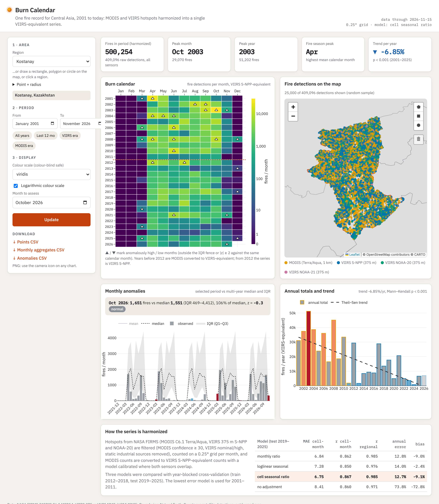
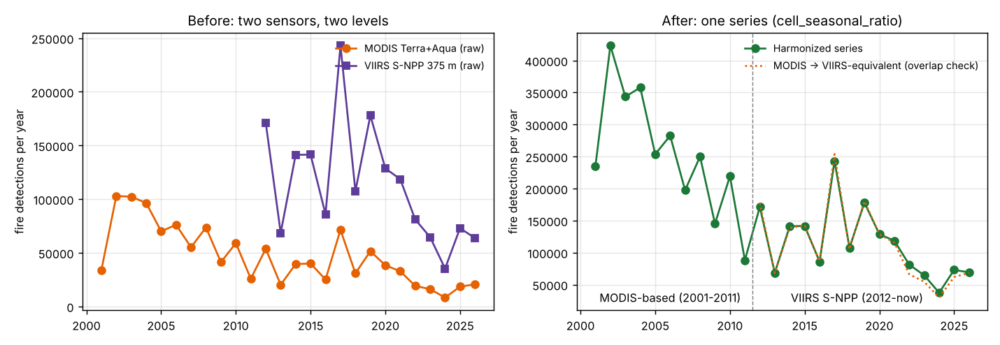
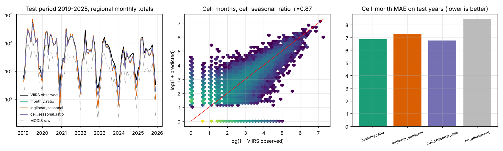

# Burn Calendar: harmonized MODIS + VIIRS fire record for Central Asia

**Live app:** https://burn-calendar.onrender.com (free tier: the first request after idle can take ~1 minute to wake up)

NASA Space Apps Challenge 2026 · *Harmonization of MODIS and VIIRS Hot Spots*

A web application that turns 25 years of NASA FIRMS active-fire detections into one consistent
**burn calendar** for Kazakhstan and its neighbours (Kyrgyzstan, Uzbekistan, Tajikistan,
Turkmenistan). MODIS (2000–present) and VIIRS (2012–present) are merged into a single monthly
series in which the satellite that saw the fire no longer matters. Pick any area, any period, and
see when it burns, whether this month is unusual, and how fire activity is trending.



## The problem

Fire services, early-warning centres and land managers need to know *when* an area normally
burns and *whether* the current season is abnormal. That requires a long record. The long record
(MODIS, 1 km, since 2000) and the detailed, current record (VIIRS, 375 m, since 2012) disagree:
VIIRS sees small fires that MODIS misses and reports about **3–5× more detections** over the same
fires. Appending one to the other creates a false jump in 2012, and comparing this year (VIIRS)
with a 2000s baseline (MODIS) gives meaningless anomalies.

## What the app does

| Feature | Details |
|---|---|
| Area selection | Draw a rectangle, polygon or circle; type lat/lon + radius; click/select any of 48 admin-1 regions, or a whole country |
| Period | Any month range 2001 – today (presets: all years, last 12 months, MODIS era, VIIRS era) |
| Burn calendar | Months × years heat map of harmonized fire counts, anomalous months marked ▲/▼, sensor change line at 2012 |
| Anomalies | Each month vs. the multi-year median, mean and IQR of the same calendar month; z-score; "month to assess" summary card; annual anomalies |
| Key indicators | Fires in period (harmonized and raw by sensor), peak month and year, fire-season peak, Theil–Sen trend with Mann–Kendall p-value |
| Map | Individual hotspots for the selected area and period, coloured by sensor (random sample of 25 000 when larger) |
| Accessibility | Colour-blind-safe scales (viridis, cividis, magma, inferno), log/linear colour scale, Okabe–Ito sensor colours, legends on every chart |
| Downloads | Points CSV (all detections in the area), monthly aggregates CSV, anomalies CSV, PNG of any chart |

## NASA data

| Dataset | Product | Period used | Access |
|---|---|---|---|
| MODIS Collection 6.1 active fire, Terra + Aqua (1 km) | MCD14ML via FIRMS | 2000-11 – 2025 archive, 2026 via API | FIRMS country archives + area API (`MODIS_SP`, `MODIS_NRT`) |
| VIIRS 375 m active fire, Suomi NPP | VNP14IMGTDL via FIRMS | 2012-01 – today | country archives + API (`VIIRS_SNPP_SP`, `VIIRS_SNPP_NRT`) |
| VIIRS 375 m active fire, NOAA-20 | VJ114IMGTDL via FIRMS | 2018 – today | country archives + API (`VIIRS_NOAA20_SP/NRT`) |
| VIIRS 375 m active fire, NOAA-21 | VJ214IMGTDL via FIRMS | 2025 – today | API (`VIIRS_NOAA21_NRT`), map only |

Source: [NASA FIRMS](https://firms.modaps.eosdis.nasa.gov). Admin boundaries: Natural Earth 1:10m
(public domain).

## Harmonization method

Everything is implemented in [`src/harmonize.py`](src/harmonize.py) and explained step by step in
[`notebooks/harmonization.ipynb`](notebooks/harmonization.ipynb).

1. **Filtering.** MODIS `confidence ≥ 30`; VIIRS `confidence ∈ {nominal, high}`; only `type = 0`
   (presumed vegetation fire): volcanoes, gas flares/industrial sites and offshore sources are removed.
   Near-real-time points have no `type`, so they are dropped if within ~1 km of a static source known
   from the archive. This matters in western Kazakhstan, where oil and gas flares would otherwise
   dominate winter months.
2. **Gridding.** Detections are counted per 0.25° × 0.25° cell and calendar month, separately for
   Terra, Aqua, S-NPP, NOAA-20 and NOAA-21.
3. **Terra-only months.** Aqua starts in July 2002. For earlier months Terra counts are scaled by the
   seasonal factor (Terra+Aqua)/Terra estimated over 2003–2011 (1.8 in summer, 3.4 in January).
4. **MODIS → VIIRS-equivalent model**, calibrated on the 2012–2025 overlap. Three models compared:
   * *Monthly ratio*: V = k<sub>m</sub>·M, one ratio per calendar month (k ranges 2.7 in March to 4.6 in June).
   * *Seasonal log-linear regression*: log(1+V) = a<sub>m</sub> + b<sub>m</sub>·log(1+M), with smearing back-transform.
   * *Cell × season ratio* (empirical Bayes): V = k<sub>m</sub>·r<sub>c</sub>·M, where the per-cell factor r<sub>c</sub>
     is shrunk toward 1 (prior strength α chosen by an inner year-split). It captures that the VIIRS/MODIS
     ratio is higher in croplands with many small fires than in steppe with large ones.
5. **Validation** with a year-blocked split: **train 2012–2018, test 2019–2025**, on 61 802 test cell-months.

| Model (test 2019–2025) | MAE cell-month | RMSE | r cell-month | r regional monthly | annual total error | bias |
|---|---:|---:|---:|---:|---:|---:|
| No adjustment (raw MODIS) | 8.41 | 26.1 | 0.860 | 0.971 | 73.8 % | −72.8 % |
| Monthly ratio | 6.84 | 16.6 | 0.862 | 0.985 | 12.8 % | −9.0 % |
| Seasonal log-linear | 7.28 | 22.3 | 0.850 | 0.976 | 14.0 % | −2.4 % |
| **Cell × season ratio (selected)** | **6.75** | **16.3** | **0.867** | **0.985** | **12.7 %** | −9.1 % |

The selected model is refitted on 2012–2025 and applied to MODIS 2001–2011. From 2012 on, the series
*is* VIIRS S-NPP. Months where S-NPP has an outage or the NRT feed lags (S-NPP < 70 % of NOAA-20 in
the region; July 2024, July 2026, November 2026) are filled with NOAA-20 counts scaled by the
S-NPP/NOAA-20 ratio. Metrics are saved in [`data/processed/metrics.json`](data/processed/metrics.json).

| Before / after | Validation |
|---|---|
|  |  |

The remaining −9 % bias in the test years comes from the orbital drift of Terra and Aqua after 2020
(the VIIRS/MODIS ratio rises from ~3.4 to ~4.2 in 2022–2025). It does not affect the reconstruction
of 2001–2011, when both MODIS orbits were stable.

**Anomaly rule.** For each calendar month, the baseline is all complete years 2001–2025 in the selected
area. A month is *high/low* when it is outside Q1 − 1.5·IQR … Q3 + 1.5·IQR or |z| ≥ 2, and
*above/below normal* when |z| ≥ 1. Trend: Theil–Sen slope on annual totals with a Mann–Kendall test.

**What it shows.** In Kazakhstan, harmonized fire detections fell from 225 000–390 000 per year in
2002–2006 to 19 000–64 000 in 2022–2025 (Theil–Sen trend −7 % per year, p < 0.001), with spring
(April) and late-summer peaks. Without harmonization this decline would be hidden by the jump in 2012.

## Run it

```bash
pip install -r requirements-dev.txt

# 1. data (≈ 400 MB raw CSV; archives need no key, the current year needs a FIRMS MAP_KEY)
export FIRMS_MAP_KEY=your_key            # https://firms.modaps.eosdis.nasa.gov/api/map_key/
python scripts/download.py               # archives + API, cached and resumable
python scripts/build_regions.py          # admin-1 boundaries

# 2. processing + harmonization + figures  (≈ 30 s)
python scripts/process.py

# 3. web app
uvicorn app.main:app --reload            # http://localhost:8000
```

The processed Parquet files are committed, so step 3 works right after cloning. Docker:
`docker build -t burn-calendar . && docker run -p 8000:8000 burn-calendar`. Render: the repo contains
`render.yaml` (free Docker web service).

### API

All endpoints take an area (`country=KAZ`, `region=<id>`, `bbox=w,s,e,n`, `polygon=lon lat,lon lat,…`
or `lat=&lon=&radius_km=`) and a period (`start=YYYY-MM&end=YYYY-MM`).

| Endpoint | Returns |
|---|---|
| `GET /api/calendar` | months × years matrix of harmonized counts, source per year |
| `GET /api/anomalies?month=YYYY-MM` | monthly and annual values with median, mean, IQR, z, flag |
| `GET /api/stats` | totals, raw counts by sensor, top months/years, trend |
| `GET /api/points` | hotspots (sampled to 25 000) |
| `GET /api/export.csv?kind=points\|aggregates\|anomalies` | CSV download |
| `GET /api/regions`, `/api/meta` | boundaries, model metrics |

Calendar and anomaly numbers are area-weighted: each 0.25° cell contributes the share of its area
inside the selected shape. Points and raw counts are exact.

## Repository layout

```
scripts/download.py       FIRMS archives + API (retries, pauses, cache)
scripts/build_regions.py  admin-1 boundaries
scripts/process.py        raw -> Parquet, harmonization, metrics, figures
src/harmonize.py          filtering, gridding, models, validation
notebooks/harmonization.ipynb
app/main.py               FastAPI backend (pandas + DuckDB over Parquet)
app/static/               single page: Leaflet + Plotly
data/processed/           points.parquet, grid_monthly.parquet, harmonized.parquet, metrics.json
submission/               Space Apps submission texts, slides, demo script
```

## Limitations

* Counts are satellite **detections**, not burned area or number of fires; one large fire gives many detections.
  Cloud cover and overpass time limit what any sensor sees.
* Before 2012, cells where MODIS saw nothing stay at zero, so very small fires that only VIIRS would
  detect are under-represented at the cell level (regional totals are corrected through k<sub>m</sub>).
* The model assumes a stable cell-level VIIRS/MODIS relationship; land-use change between the 2000s and
  2010s can bias individual cells.
* 0.25° grid: calendars for very small areas are approximated by fractional cell weights.
* Natural Earth boundaries predate the 2022 regional reform in Kazakhstan (Abai, Jetisu, Ulytau are not
  separate regions); draw the area to analyse them.
* Near-real-time data are refreshed by re-running `download.py` and `process.py`; the last month is
  marked as incomplete.

## License

Code: MIT. Data: NASA FIRMS (no restrictions on use, please cite LANCE FIRMS) and Natural Earth (public domain).

> We acknowledge the use of data and imagery from NASA's Fire Information for Resource Management
> System (FIRMS) (https://www.earthdata.nasa.gov/firms), part of NASA's Earth Science Data and
> Information System (ESDIS).
