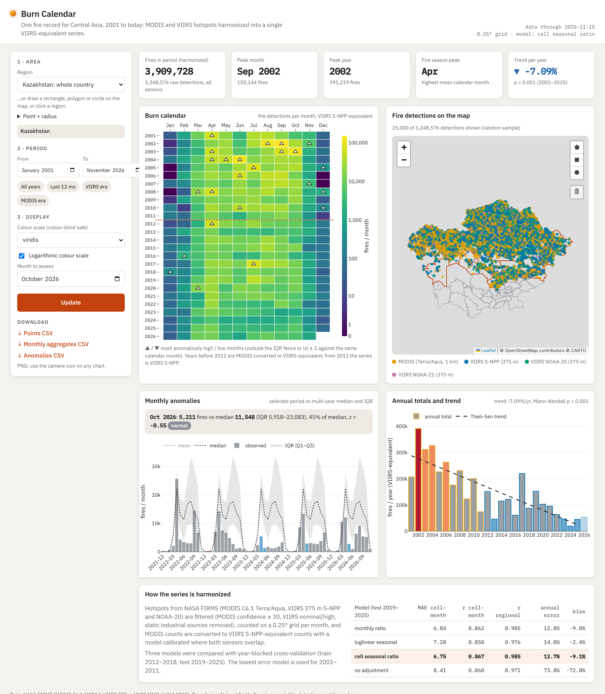
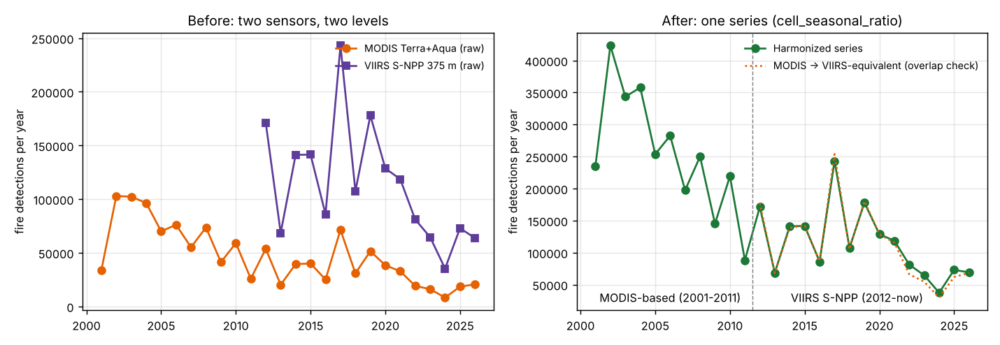
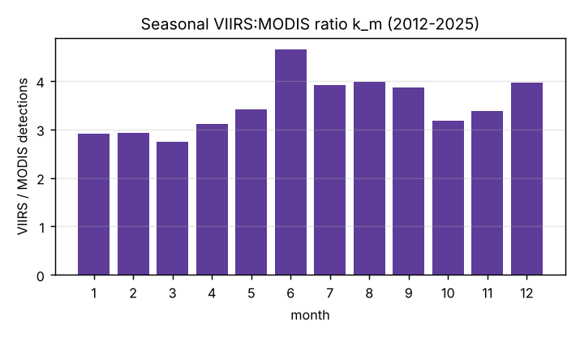
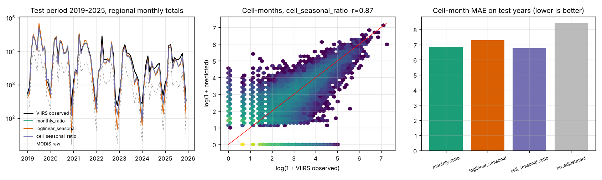
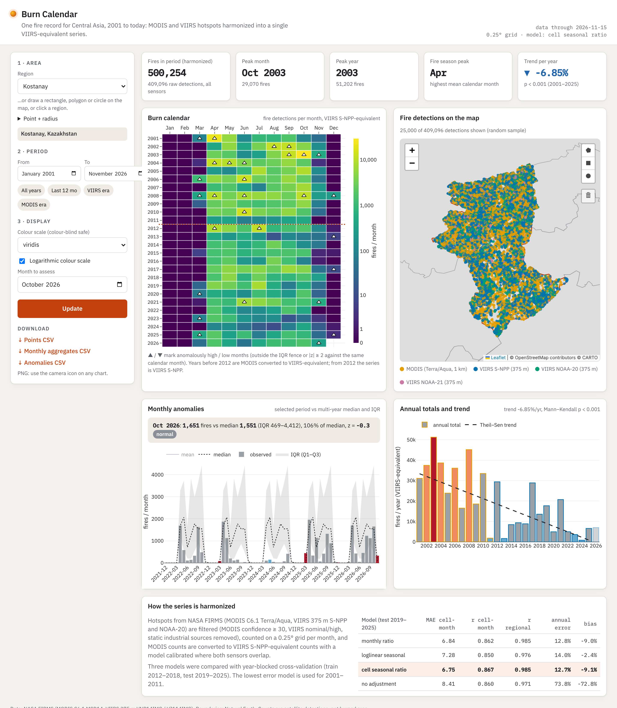

# 1 · Burn Calendar

**One fire record for Central Asia, 2001 to today**

* Harmonized MODIS + VIIRS active-fire calendar for Kazakhstan, Kyrgyzstan, Uzbekistan, Tajikistan, Turkmenistan
* Any area · any period · anomalies · trend · downloads
* Live app: https://burn-calendar.onrender.com

---

# 2 · The problem: two satellites, two truths

* MODIS (1 km) gives the long record since 2000; VIIRS (375 m) the detailed one since 2012
* Over the same fires VIIRS reports **3–5× more detections**
* Joining them creates a false jump in 2012; comparing this year with a 2000s baseline gives wrong anomalies
* Fire services need: *When does my area burn? Is this month abnormal? Is it getting worse?*

---

# 3 · Data: NASA FIRMS, 3.9 million hotspots

* MODIS C6.1 Terra + Aqua, 2000–2026
* VIIRS 375 m S-NPP 2012–2026, NOAA-20 2018–2026, NOAA-21 (current year)
* Yearly country archives + FIRMS area API for the current year (batched, cached)
* Cleaning: MODIS confidence ≥ 30, VIIRS nominal/high, static sources removed (gas flares, industry)
* Counted per 0.25° cell × month

---

# 4 · Harmonization: MODIS → VIIRS-equivalent

* Terra-only months (before Aqua, 2002) scaled by seasonal Terra+Aqua/Terra factor
* Three models calibrated on the 2012–2025 overlap:
    1. seasonal ratio  V = km·M
    2. seasonal log-linear regression
    3. **cell × season ratio** with empirical-Bayes shrinkage  V = km·rcell·M
* Applied to 2001–2011; from 2012 the series is VIIRS S-NPP (NOAA-20 fills S-NPP outages)

---

# 5 · Validation: train 2012–2018, test 2019–2025

| | raw MODIS | ratio | log-linear | **cell × season** |
|---|---:|---:|---:|---:|
| MAE per cell-month | 8.41 | 6.84 | 7.28 | **6.75** |
| r regional monthly | 0.971 | 0.985 | 0.976 | **0.985** |
| annual total error | 73.8 % | 12.8 % | 14.0 % | **12.7 %** |
| bias | −72.8 % | −9.0 % | −2.4 % | −9.1 % |

61 802 test cell-months. Remaining bias = Terra/Aqua orbital drift after 2020.

---

# 6 · The app

* Draw a polygon, rectangle or circle, enter lat/lon + radius, or pick one of 48 regions
* **Burn calendar** months × years, anomalous months marked
* **Anomalies** vs 25-year median, mean, IQR, z-score; "is this month normal?" card
* **Indicators**: fires in period, peak month/year, fire-season peak, Theil–Sen trend
* **Map** of individual hotspots by sensor
* Colour-blind-safe scales · CSV and PNG downloads · open JSON API

---

# 7 · Impact and next steps

* Kazakhstan: harmonized fire detections fell from 225–390 k/yr (2002–2006) to 19–64 k/yr (2022–2025), **−7 %/yr, p < 0.001**. The raw data hide this.
* For emergency services: plan for the expected season, spot abnormal months early, report by region
* For science and land management: one consistent 25-year record, open code and data
* Next: burned-area layer (MCD64A1), daily NRT refresh, alerts for abnormal months, all of Eurasia
